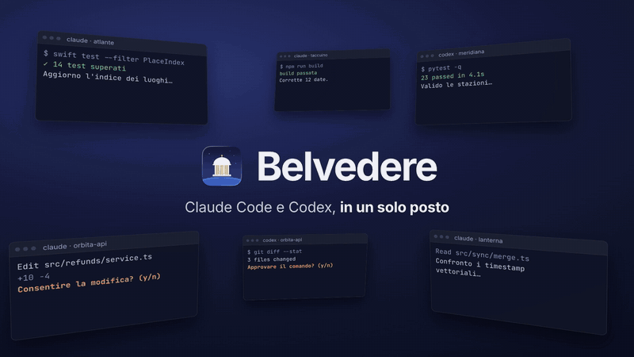
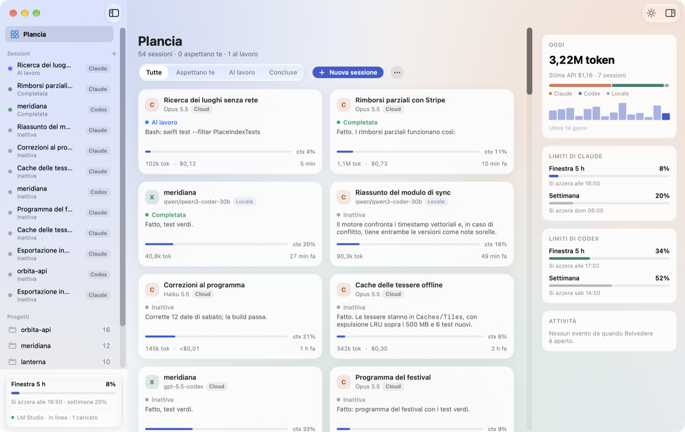
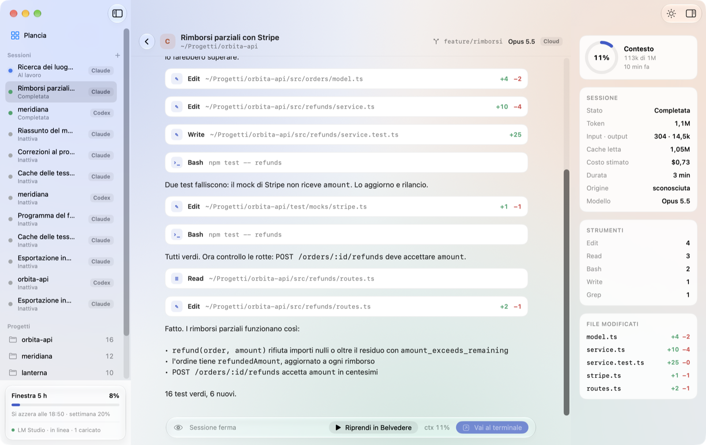
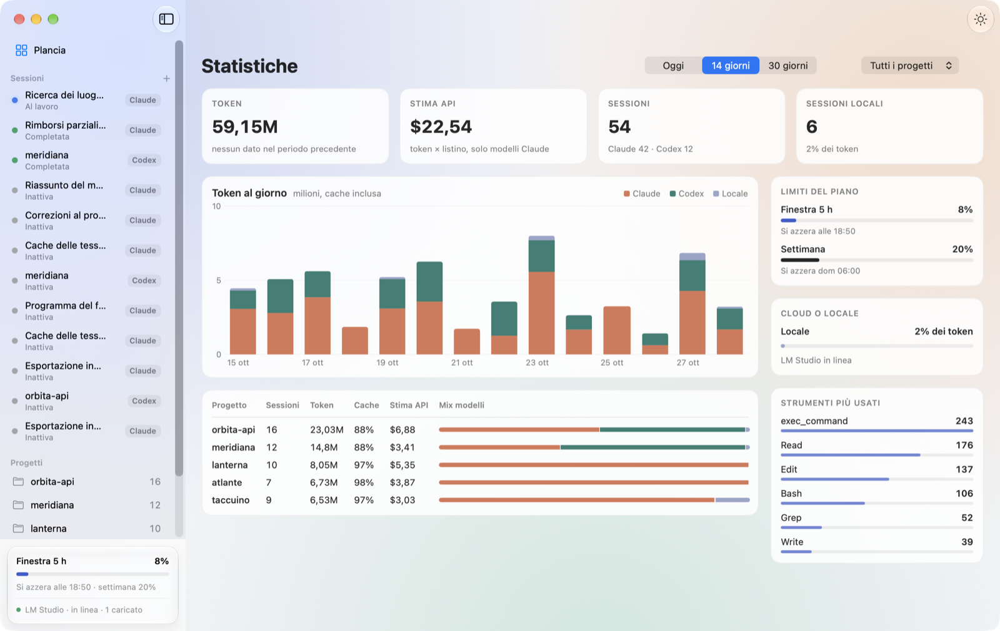

# Belvedere

App macOS nativa che riunisce in un solo posto le sessioni di **Claude Code** e **Codex**: le lancia, le mostra come chat, tiene d'occhio anche quelle aperte nel terminale o nell'IDE e mostra in tempo reale token, contesto e limiti del piano.

*A native macOS app that brings your Claude Code and Codex sessions together: launch them, chat with them, watch the ones running in your terminal or IDE, and keep an eye on tokens, context and plan limits. The interface is in Italian.*

<p align="center"></p>

> Belvedere è un progetto indipendente: non è affiliato ad Anthropic né a OpenAI. Usa le CLI `claude` e `codex` che hai già installato, così come sono.

## Cosa fa

- **Plancia**: tutte le sessioni a colpo d'occhio, con stato (al lavoro, ti aspetta, conclusa), contesto usato, token e ultima attività. Anche quelle aperte da terminale o IntelliJ.
- **Chat**: lancia sessioni Claude Code (`claude -p` in stream-json) e Codex (`codex app-server`) in qualunque cartella, con modello cloud o locale (LM Studio). Strumenti compatti, diff, richieste di permesso come card, slash command, Remote Control (`/rc`), messaggi in coda, «Ferma».
- **Permessi e domande** a cui rispondere dalla Plancia, dalla menu bar o dal notch, senza aprire la sessione.
- **Statistiche**: token al giorno, progetti, strumenti più usati, quota cloud/locale e una stima del costo a prezzi API.
- **Limiti del piano** di Claude e di Codex (finestra di 5 ore e settimanale).
- **Profili** per più account di Claude Code e Codex: ognuno nella sua cartella (`CLAUDE_CONFIG_DIR`, `CODEX_HOME`), con un profilo attivo per le nuove sessioni. La Plancia mette in risalto le sessioni del profilo attivo, e «Continua con…» porta una conversazione su un altro account quando finiscono i limiti.
- **Plugin di Claude Code** da un pannello nativo, sopra `claude plugin`.
- Menu bar, notch, tema chiaro e scuro, avvio al login.

## Schermate

**La Plancia**: tutte le sessioni, chi è al lavoro e chi ti aspetta, con i limiti del piano accanto.

<picture>
  <source media="(prefers-color-scheme: dark)" srcset="docs/images/plancia-dark.png">
  
</picture>

**Una sessione**: la chat con strumenti compatti e diff, e accanto contesto, token, costo stimato e file modificati.

<picture>
  <source media="(prefers-color-scheme: dark)" srcset="docs/images/sessione-dark.png">
  
</picture>

**Statistiche**: token al giorno per Claude, Codex e modelli locali, progetti, strumenti più usati.

<picture>
  <source media="(prefers-color-scheme: dark)" srcset="docs/images/stats-dark.png">
  
</picture>

*Le schermate usano dati di prova.*

## Requisiti

- macOS 26 o successivo, Apple Silicon o Intel.
- [Claude Code](https://docs.claude.com/en/docs/claude-code) installato e con l'accesso già fatto.
- Facoltativi: [Codex CLI](https://github.com/openai/codex) e [LM Studio](https://lmstudio.ai) per i modelli locali (su `localhost:1234`).

## Installazione

1. Scarica il DMG dell'ultima versione dalla pagina [Releases](../../releases).
2. Aprilo e trascina **Belvedere** in **Applicazioni**.
3. Al primo avvio, «Collega Claude Code» aggiunge i hook e la status line di Belvedere.

L'app è firmata con Developer ID e notarizzata da Apple: si apre con un doppio clic, senza passare dalle impostazioni di sicurezza.

## Cosa tocca sul tuo Mac

- **`~/.claude/settings.json`**: solo quando lo chiedi tu, con «Collega Claude Code». Belvedere aggiunge i propri hook e la status line, e prima salva una copia accanto al file (`settings.json.belvedere-<data>.bak`). «Scollega Claude Code» nelle Impostazioni li toglie. Con più profili vale lo stesso per il `settings.json` di ciascun profilo Claude.
- **Le cartelle dei profili** che crei (di solito `~/.claude-<nome>` o `~/.codex-<nome>`): Belvedere ci copia, se lo chiedi, le impostazioni del profilo principale senza chiavi né token. Il login lo fa la CLI nel Terminale. Eliminare un profilo non cancella la sua cartella. «Continua con…» sposta il file della conversazione da un profilo all'altro e cancella l'originale solo dopo la prima risposta riuscita.
- **`~/Library/Application Support/Belvedere`**: due piccoli helper (`belvedere-hook`, `belvedere-statusline`) e la cache dell'indice delle sessioni.
- **Un server locale su `127.0.0.1:47615`**, che riceve gli eventi dei hook. Non è raggiungibile da altri computer.

Belvedere legge i log delle sessioni in `~/.claude/projects` e `~/.codex/sessions`, e nelle stesse sottocartelle di ogni profilo. Non legge, salva o trasmette credenziali, token o dati dell'account. Non modifica `~/.codex/config.toml` e non manda nulla in rete: parla solo con `localhost` (i propri helper e LM Studio), e le uniche connessioni verso l'esterno sono quelle delle CLI che lancia.

## Compilare dal codice

Servono Xcode 26 e [XcodeGen](https://github.com/yonaskolb/XcodeGen) (`brew install xcodegen`).

```sh
scripts/build-app.sh   # build di sviluppo, firma ad-hoc
scripts/t.sh           # test (Swift Testing)
```

L'app compilata è in `build/DerivedData/Build/Products/Debug/Belvedere.app`. La logica è nel pacchetto Swift `BelvedereCore` (`Sources/`), l'interfaccia SwiftUI in `App/`.

## Contribuire

Le modifiche passano da una pull request verso `main`: i test girano in automatico e il merge si fa quando sono verdi. Per una modifica grande apri prima una issue, così ne parliamo.

## Licenza

[MIT](LICENSE) © 2026 Vito Saulle
